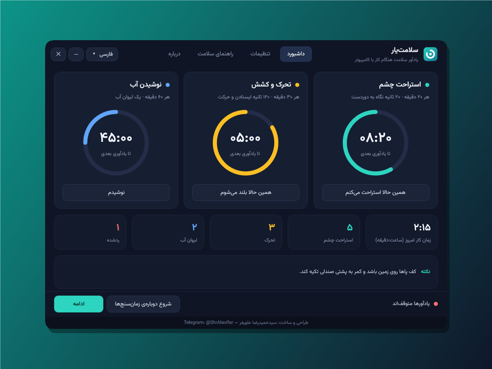

# سلامت‌یار

یادآور رایگان سلامت هنگام کار با کامپیوتر، برای ویندوز ۱۰ و ۱۱. به نصب هیچ چیز نیاز ندارد.

**زبان‌ها:** فارسی · English · العربية · Русский · 中文 — [English README](README.md)

## چه می‌کند

- **استراحت چشم:** هر ۲۰ دقیقه، ۲۰ ثانیه نگاه به فاصله‌ی حدود ۶ متر (قانون ۲۰-۲۰-۲۰).
- **تحرک و کشش:** هر ۳۰ دقیقه، ۲ دقیقه ایستادن و حرکت، با تمرین پیشنهادی.
- **نوشیدن آب:** هر ۶۰ دقیقه یک پیام کوچک.
- زنگ برای هر پیام و موسیقی در زمان استراحت. می‌توانید فایل صوتی دلخواهتان را انتخاب کنید.
- آمار روزانه، تشخیص غیبت از پشت سیستم و راهنمای ارگونومی با ذکر منبع.
- پوسته‌ی تاریک، روشن یا خودکار. همه‌ی عددها در تنظیمات قابل تغییر است.

## اجرا

1. مخزن را دانلود کنید (Code ← Download ZIP) و از حالت فشرده خارج کنید.
2. روی `Run.cmd` دوبار کلیک کنید. اگر ویندوز هشدار امنیتی داد، «Run» یا «Open» را بزنید.
3. بار اول فایل‌های صدا و میان‌بر آیکون‌دار `SalamatYar` در همان پوشه ساخته می‌شود.

بستن پنجره برنامه را نمی‌بندد؛ نشان آن کنار ساعت ویندوز می‌ماند. برای خروج روی آن راست‌کلیک کنید.

## عددهای پیش‌فرض از کجا آمده‌اند

| یادآور | پیش‌فرض | مبنا |
| --- | --- | --- |
| استراحت چشم | هر ۲۰ دقیقه، ۲۰ ثانیه | قانون ۲۰-۲۰-۲۰: انجمن اپتومتری آمریکا و آکادمی چشم‌پزشکی آمریکا |
| تحرک | هر ۳۰ دقیقه، ۲ دقیقه | HSE بریتانیا، الگوی ۲۰-۸-۲ دانشگاه کرنل، رهنمود ۲۰۲۰ سازمان جهانی بهداشت |
| آب | هر ۶۰ دقیقه | عدد انتخابی؛ استاندارد واحدی ندارد |

برای تحرک استاندارد جهانی واحدی وجود ندارد و پیش‌فرض‌ها برآیند چند توصیه‌ی منتشرشده است. این برنامه ابزار یادآوری است و جایگزین توصیه‌ی پزشک نیست.

## حریم خصوصی

برنامه به اینترنت وصل نمی‌شود. تنظیمات و آمار فقط در پوشه‌ی خود برنامه ذخیره می‌شود.

## مشارکت

برای افزودن زبان، اصلاح ترجمه یا تغییر کد، [CONTRIBUTING.md](CONTRIBUTING.md) را ببینید.

## مجوز

[MIT](LICENSE). استفاده، تغییر و بازنشر آزاد است؛ فقط نام سازنده و متن مجوز باید بماند.

---

طراحی و ساخت: سیدحمیدرضا علویفر — Telegram: [@ShrAlavifar](https://t.me/ShrAlavifar)
