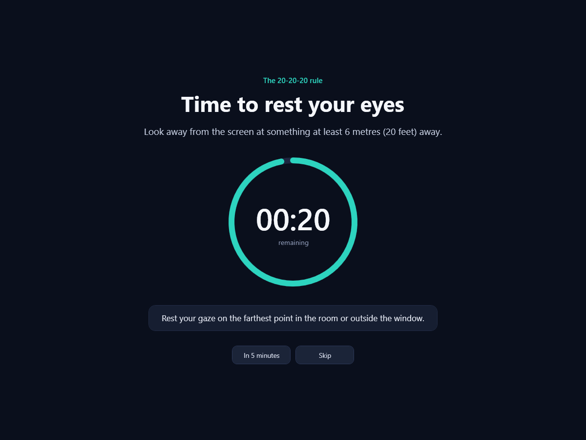

# SalamatYar

A free health reminder for people who spend hours at a computer. Windows 10 and 11, no installation.

**Languages:** فارسی · English · العربية · Русский · 中文 — [راهنمای فارسی](README.fa.md)

## What it does

- **Eye break:** every 20 minutes, look about 6 metres (20 feet) away for 20 seconds (the 20-20-20 rule).
- **Move and stretch:** every 30 minutes, stand up and move for 2 minutes, with a suggested stretch.
- **Water:** a small reminder every 60 minutes.
- A chime for every message and music during breaks. You can pick your own audio files.
- Daily statistics, absence detection (time away from the computer counts as a break) and an ergonomics guide with sources.
- Dark, light and automatic themes. Every timing can be changed in the settings.

| Break screen | Five languages | Persian (right-to-left) |
| --- | --- | --- |
|  |  |  |

## Run it

1. Download the repository (Code → Download ZIP) and extract it.
2. Double-click `Run.cmd`. If Windows shows a security warning, choose Run or Open.
3. On first run the app generates its sound files and an icon shortcut named `SalamatYar` in the same folder.

Closing the window does not exit the app; it stays next to the Windows clock. Right-click its icon to exit.

## Where the default timings come from

| Reminder | Default | Based on |
| --- | --- | --- |
| Eye break | every 20 min, 20 sec | 20-20-20 rule: American Optometric Association, American Academy of Ophthalmology |
| Movement | every 30 min, 2 min | UK HSE (short, frequent breaks), Cornell 20-8-2 pattern, WHO 2020 guidelines |
| Water | every 60 min | A convenience default; there is no single standard |

There is no single worldwide standard for movement breaks; the defaults combine several published recommendations. SalamatYar is a reminder tool and does not replace medical advice.

## Privacy

The app never connects to the internet. Settings and statistics are stored only in the app folder.

## How it is built

A single PowerShell script (`SalamatYar.ps1`) with a WPF interface, so it runs on a stock Windows installation with nothing to install. Sounds and music are synthesized by the app itself. All interface text lives in `lang.json`.

See [CONTRIBUTING.md](CONTRIBUTING.md) to add a language, fix a translation or change the code.

## License

[MIT](LICENSE). You may use, change and share it freely; keep the copyright notice.

## Author

Seyed Hamidreza Alavifar — Telegram: [@ShrAlavifar](https://t.me/ShrAlavifar)
