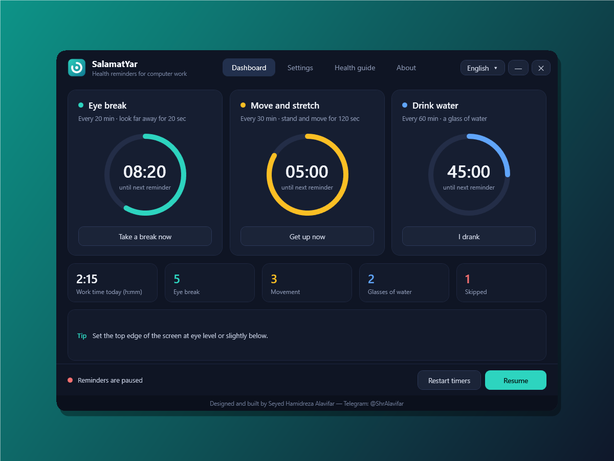
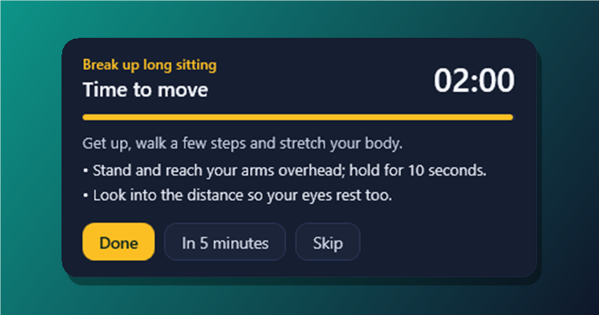
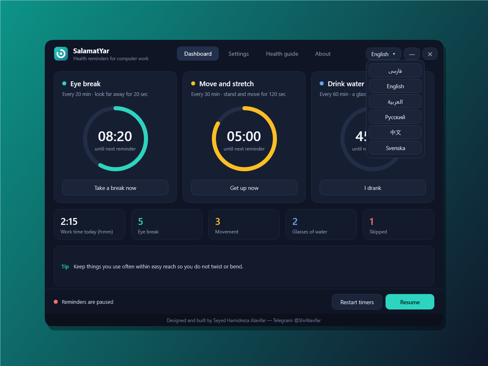
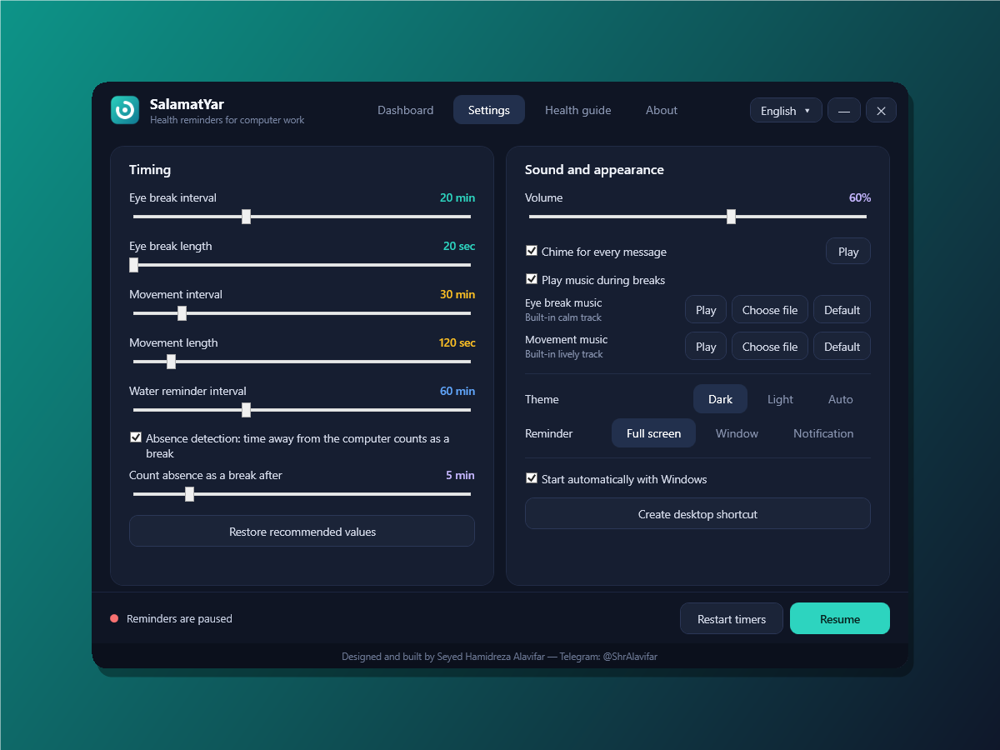
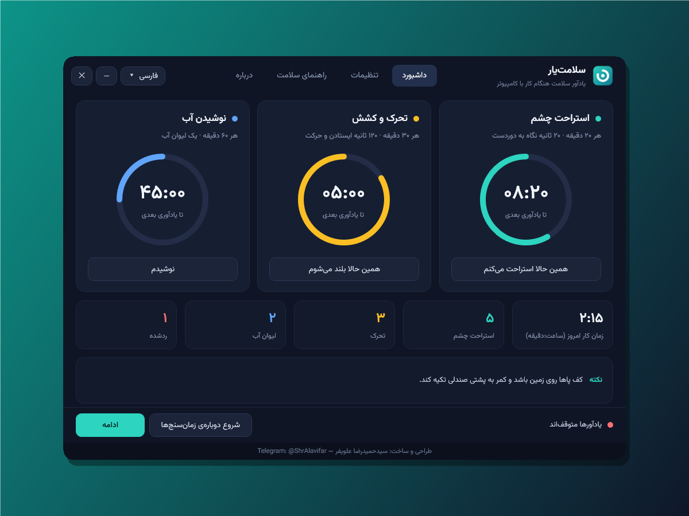

# SalamatYar — free break reminder for Windows

A free, open-source health reminder for people who spend hours at a computer: eye breaks with the 20-20-20 rule, movement and stretch breaks, and water reminders. Windows 10 and 11, nothing to install, no data leaves your computer.

**Languages:** فارسی · English · العربية · Русский · 中文 — [راهنمای فارسی](README.fa.md)

**[⬇ Download SalamatYar (ZIP, ready to run)](https://github.com/alavifar/SalamatYar/releases/latest/download/SalamatYar.zip)**

If SalamatYar helps you, a ⭐ on this repository helps other people find it.

## What it does

- **Eye break:** every 20 minutes, look about 6 metres (20 feet) away for 20 seconds (the 20-20-20 rule).
- **Move and stretch:** every 30 minutes, stand up and move for 2 minutes.
- **Water:** a small reminder every 60 minutes.
- **58 suggested activities:** 14 for the eyes, 22 stretches and movements, 8 water habits and 14 ergonomics tips. Each reminder shows one or two, and none repeats until the whole set has been shown.
- **Three reminder styles:** full screen, a small window in the corner, or only a notification next to the Windows clock.
- A chime for every message and music during breaks. You can pick your own audio files.
- Daily statistics, absence detection (time away from the computer counts as a break) and an ergonomics guide with sources.
- Dark, light and automatic themes. Every timing can be changed, and each setting shows a preview the moment you change it.

| Full screen | Small window | Five languages |
| --- | --- | --- |
|  |  |  |

| Settings | Persian (right-to-left) |
| --- | --- |
|  |  |

## Run it

1. [Download SalamatYar.zip](https://github.com/alavifar/SalamatYar/releases/latest/download/SalamatYar.zip) and extract the whole folder.
2. Double-click `SalamatYar.exe`.
3. On first run the app generates its sound files in the same folder.

The program is not code-signed, so Windows may show "Windows protected your PC" the first time. Choose **More info**, then **Run anyway**. `SalamatYar.exe` is only a small launcher for `SalamatYar.ps1`; its source is in [launcher/Launcher.cs](launcher/Launcher.cs). If you prefer not to run the launcher, double-click `Run.cmd` instead.

Closing the window does not exit the app; it stays next to the Windows clock. Right-click its icon to exit.

## Where the default timings come from

| Reminder | Default | Based on |
| --- | --- | --- |
| Eye break | every 20 min, 20 sec | 20-20-20 rule: American Optometric Association, American Academy of Ophthalmology |
| Movement | every 30 min, 2 min | UK HSE (short, frequent breaks), Cornell 20-8-2 pattern, WHO 2020 guidelines |
| Water | every 60 min | A convenience default; there is no single standard |

There is no single worldwide standard for movement breaks; the defaults combine several published recommendations. SalamatYar is a reminder tool and does not replace medical advice.

## Privacy

The app never connects to the internet. Settings and statistics are stored only in the app folder.

## Frequently asked questions

**Is it really free?** Yes. It is released under the MIT license, with no ads, accounts or tracking.

**Why does Windows warn me?** The launcher is not code-signed. The whole source is in this repository, and you can start the app with `Run.cmd` instead of the launcher.

**Can I change the timings?** Yes, everything is in Settings, with a button to return to the recommended values.

**Can it start with Windows?** Yes, there is a checkbox in Settings.

**My language is missing or a translation is wrong.** All texts are in `lang.json`. See [CONTRIBUTING.md](CONTRIBUTING.md); corrections from native speakers are very welcome.

## How it is built

A single PowerShell script (`SalamatYar.ps1`) with a WPF interface, so it runs on a stock Windows installation with nothing to install. Sounds and music are synthesized by the app itself. All interface text lives in `lang.json`. `tools/build.ps1` compiles the launcher and builds the download package with the C# compiler that ships with Windows.

See [CONTRIBUTING.md](CONTRIBUTING.md) to add a language, fix a translation or change the code, and [CHANGELOG.md](CHANGELOG.md) for the release history.

## macOS and Linux

A cross-platform edition for Windows, macOS and Linux is being built with Tauri in the [app/](app/) folder. It is a preview and needs testers, especially on macOS and Linux. See [app/README.md](app/README.md).

## License

[MIT](LICENSE). You may use, change and share it freely; keep the copyright notice.

## Author

Seyed Hamidreza Alavifar — Telegram: [@ShrAlavifar](https://t.me/ShrAlavifar)
